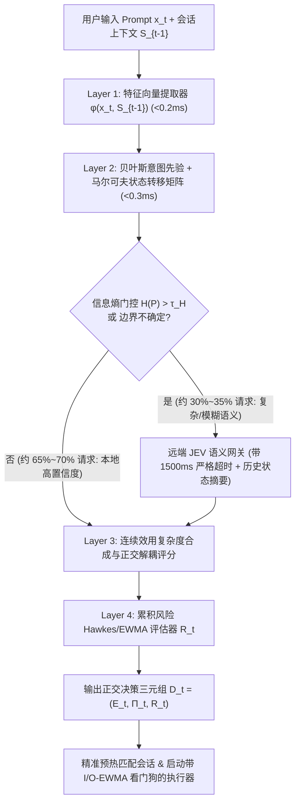

# Antigravity Feishu Bot (v3.2) 全量代码深度审计与架构重构开发规格书

- **文档版本**：v3.2.0-RFC
- **审计范围**：`antigravity-feishu-bot` 全量核心模块与插件生态
- **文档性质**：深度缺陷排查报告 + JEV 数理决策模型重构设计 + 工程开发规格书（Spec）
- **核心目标**：彻底根治已知 3 大顽疾、消除 18 项深层逻辑漏洞与安全隐患、构建“本地数理模型 + 远端 JEV 语义网关”双层混合决策系统，实现 7×24 小时无人值守高可靠运行。

---

## 目录

1. [项目全景功能大项梳理与架构评估](#1-项目全景功能大项梳理与架构评估)
2. [三大已知问题的代码级根因剖析与修复规格](#2-三大已知问题的代码级根因剖析与修复规格)
   - [2.1 问题一：任务执行步骤未按“3~4 步”规则显示，出现大量杂乱步骤](#21-问题一任务执行步骤未按34-步规则显示出现大量杂乱步骤)
   - [2.2 问题二：任务执行完毕后最终结果偶发混入后台思考内容（Thinking 泄露）](#22-问题二任务执行完毕后最终结果偶发混入后台思考内容thinking-泄露)
   - [2.3 问题三：偶发个别任务执行卡死、零进展且无法自动熔断恢复](#23-问题三偶发个别任务执行卡死零进展且无法自动熔断恢复)
3. [八大核心功能模块深度排查：逻辑漏洞、稳定性、安全与性能](#3-八大核心功能模块深度排查逻辑漏洞稳定性安全与性能)
   - [3.1 核心执行引擎与持久会话池 (`executor.py` / `session_pool.py` / `pipeline.py`)](#31-核心执行引擎与持久会话池-executorpy--session_poolpy--pipelinepy)
   - [3.2 JEV (System One) 决策模型网关 (`system_one_gate.py`)](#32-jev-system-one-决策模型网关-system_one_gatepy)
   - [3.3 计划任务调度系统 (`cron_engine.py` vs `plugins/cron_scheduler`)](#33-计划任务调度系统-cron_enginepy-vs-pluginscron_scheduler)
   - [3.4 插件系统与扩展生态 (`plugin_manager.py` / `plugins/*`)](#34-插件系统与扩展生态-plugin_managerpy--plugins)
   - [3.5 用户权限、认证与配额系统 (`utils/auth.py` / `commands.py` / `card_actions.py`)](#35-用户权限认证与配额系统-utilsauthpy--commandspy--card_actionspy)
   - [3.6 飞书交互卡片、多模态与语音服务 (`cards/*` / `multimodal.py` / `voice_service.py`)](#36-飞书交互卡片多模态与语音服务-cards--multimodalpy--voice_servicepy)
   - [3.7 数据库存储与垃圾回收系统 (`database.py` / `garbage_collection.py`)](#37-数据库存储与垃圾回收系统-databasepy--garbage_collectionpy)
   - [3.8 外部硬件桥接与更新子系统 (`passport_bridge` / `rpi_gpio_*` / `system_updater`)](#38-外部硬件桥接与更新子系统-passport_bridge--rpi_gpio_--system_updater)
4. [JEV 决策模型深度评估与“数理统计决策模型系统”重构规格](#4-jev-决策模型深度评估与数理统计决策模型系统重构规格)
   - [4.1 现有 JEV (System One) 决策架构的四大核心缺陷](#41-现有-jev-system-one-决策架构的四大核心缺陷)
   - [4.2 是否需要引入数学模型系统？结论与收益量化](#42-是否需要引入数学模型系统结论与收益量化)
   - [4.3 重构方案：四层混合数理决策架构 (HMDM - Hybrid Mathematical Decision Model)](#43-重构方案四层混合数理决策架构-hmdm---hybrid-mathematical-decision-model)
   - [4.4 核心数学模型定义、公式推导与参数设计](#44-核心数学模型定义公式推导与参数设计)
   - [4.5 数理决策引擎 Python 标准接口与代码规格](#45-数理决策引擎-python-标准接口与代码规格)
5. [长期运行稳定性（7×24h 老化故障）专项排查表](#5-长期运行稳定性724h-老化故障专项排查表)
6. [分阶段工程实施路线图与验收标准](#6-分阶段工程实施路线图与验收标准)

---

## 1. 项目全景功能大项梳理与架构评估

当前项目采用 **Python Asyncio + 飞书长连接 (WebSocket) + Persistent Agy Warm Pool + System One (JEV) 认知网关 + 插件化架构**，整体划分为以下 **8 大功能子系统**：

| 序号 | 功能大项 | 核心代码文件 | 当前成熟度 | 风险等级 | 核心审计结论简述 |
| :--- | :--- | :--- | :---: | :---: | :--- |
| **01** | **核心执行与会话温池系统** | `executor.py`, `session_pool.py`, `handlers/pipeline.py`, `agy_daemon.py` | ★★★☆☆ | **高危 (P0)** | 存在子进程休眠态误判导致死锁看门狗失效、每条消息 `importlib.reload` 破坏全局状态、预热竞争条件、思考文本跨轮次拼接污染。 |
| **02** | **JEV (System One) 决策模型系统** | `system_one_gate.py`, `cards/system_one_card.py` | ★★★☆☆ | **高危 (P0)** | 远端 API 延迟高（1.5~2.5s）、硬编码阶跃阈值失调、`Medium` 档位与 `[TASK_PLAN]` 逻辑脱节、无对话状态转移记忆、无累积风险建模。 |
| **03** | **流式卡片与步骤指示器系统** | `cards/indicators.py`, `cards/response.py`, `lark_client.py` | ★★★☆☆ | **中危 (P1)** | `planned_steps` 与 `completed_tool_steps` 双轨制分叉；备用计划生成器 `generate_task_plan` 写好却从未调用；正则拆分在流式阶段易产生碎片步骤。 |
| **04** | **计划任务调度系统 (Cron)** | `cron_engine.py`, `plugins/cron_scheduler/*`, `cards/cron.py` | ★★☆☆☆ | **高危 (P0)** | **双引擎冲突**：主程序 `cron_engine` 与插件 `cron_scheduler` 同时读写同一张表，且两处 `CREATE TABLE cron_tasks` 表结构不一致；卡片按钮触发双重执行。 |
| **05** | **用户权限与安全审计系统** | `utils/auth.py`, `handlers/events.py`, `handlers/card_actions.py`, `commands.py` | ★★☆☆☆ | **高危 (P0)** | **多处越权漏洞**：普通用户可通过 `/project` 或卡片切换工作目录至系统敏感目录（如 `/etc`）并通过附件回传读取任意文件；`SCOPE_SHELL` 未与 `--sandbox` 绑定。 |
| **06** | **插件中心与扩展系统** | `plugin_manager.py`, `plugin_base.py`, `plugin_store.py`, `plugins/*` | ★★★☆☆ | **中危 (P1)** | 核心指令（`/note`, `/memory`, `/cron`, `/update`）在 `commands.py` 与 `plugins/` 中重复实现；插件重载缺少生命周期锁与后台线程回收。 |
| **07** | **多模态、语音与文件投递系统** | `multimodal.py`, `voice_service.py`, `handlers/media.py`, `send_to_feishu.py` | ★★★★☆ | **中危 (P1)** | `voice_service.py` 每次合成重新加载 Piper 模型/子进程；`multimodal.py` 路径校验依赖 `allowed_dirs`，被越权修改 `workspace_root` 后可被绕过。 |
| **08** | **数据库存储与垃圾回收系统** | `database.py`, `garbage_collection.py`, `stats.py` | ★★★☆☆ | **中危 (P1)** | 根目录遗留 4 个不同名 `.db` 文件；每次查询新建连接未设置 `PRAGMA busy_timeout`；GC 任务在主事件循环同步执行 `VACUUM` 阻塞心跳；`cron_logs` 无清理机制。 |

---

## 2. 三大已知问题的代码级根因剖析与修复规格

### 2.1 问题一：任务执行步骤未按“3~4 步”规则显示，出现大量杂乱步骤

#### 1) 现象描述
正常情况下任务卡片应展示 3~4 个高层次阶段步骤（如 `1. 解析需求 -> 2. 检索代码 -> 3. 生成文档`），但实际运行中经常退化为展示 5~6 行甚至不断滚动的底层工具动作明细（如 `正在读取 a.py`、`正在读取 b.py`、`正在执行 bash...`）。

#### 2) 代码级根因定位（三重缺陷叠加）
1. **根因 A（核心逻辑断层）：`Medium` 档位任务被剥夺了 `[TASK_PLAN]` 注入指令**
   - 在 `handlers/pipeline.py:516-528` 中：
     ```python
     is_complex_agent = (
         session_data.get("mode") == "agent" or adaptive_tier == "High"
     )
     if is_complex_agent:
         system_instruction += (
             "\n\n[System Task Plan Protocol]\n"
             "如果用户的请求包含明确的操作、查询、修改或执行任务，你必须在回复的最开头第一行输出3到5个简短的执行步骤计划，格式严格为：[TASK_PLAN]步骤1|步骤2|步骤3[/TASK_PLAN]..."
         )
     ```
   - 而在 `system_one_gate.py:917-934` 的 `evaluate_adaptive_tier()` 中，绝大多数常规开发、文件处理、脚本执行任务的 `complexity_score` 在 `0.6 ~ 1.6` 之间，被判定为 `adaptive_tier = "Medium"`！
   - 当开启 `TYPESAFE_AUTO_MODE = True`（默认开启）且会话处于默认模式时，`adaptive_tier == "Medium"` 导致 `is_complex_agent` 为 **`False`**！大模型根本没有收到 `[TASK_PLAN]` 协议指令，因此 `planned_steps` 永远为空列表 `[]`。
2. **根因 B：`build_tool_indicator` 在无计划时退化为底层工具流水账，且上限算式超标**
   - 在 `cards/indicators.py:408-474` 中，当 `planned_steps` 为空时，走入 `completed_tool_steps` 分支（第 456~473 行）：
     - `max_visible_history = 4`（显示最近 4 个底层工具动作）；
     - 加上折叠提示行 `*(已完成前 N 个执行步骤)*`（第 1 行）；
     - 加上当前正在执行的 `action_disp`（第 6 行）；
     - 导致界面上同时出现 **6 行细粒度工具调用流水账**，且每次切换文件/命令都会刷出新步骤。
3. **根因 C：本地兜底计划生成器 `generate_task_plan()` 写好却成了“死代码”，且流式正则解析易碎**
   - `cards/indicators.py:199-286` 专门编写了 `generate_task_plan(prompt_text)`（能按语义自动生成 3~4 个标准步骤），并在 `cards/__init__.py:23` 挂载到了 `CardBuilder.generate_task_plan`，但**在整个代码库中没有任何地方调用它**！
   - 此外，`cards/indicators.py:184-196` 的 `parse_task_plan()` 使用 `re.split(r'[\|\n\r]+', raw)`，且截断上限为 `steps[:5]`（5 步而非 4 步）。当模型输出列表式计划时，换行符会导致拆出大量碎片步骤。

#### 3) 修复规格（Specification）
1. **统一计划触发条件**：在 `handlers/pipeline.py:516` 中，将 `[TASK_PLAN]` 注入条件从 `adaptive_tier == "High"` 扩展为 **所有非纯闲聊的操作型任务**（即 `not is_pure_qa` 或 `adaptive_tier in ("Medium", "High")` 或 `needs_terminal`）。
2. **启用双层兜底收敛机制（保证 100% 遵循 3~4 步规则）**：
   - 在 `executor.py` 进入首个工具调用（`tool_call` / `tool_Action`）时，若检测到 `not planned_steps`，**立即调用 `CardBuilder.generate_task_plan(prompt_text)` 生成 3~4 个标准宏观阶段步骤**赋值给 `planned_steps`。
   - 将所有细粒度底层工具动作（如连续读 10 个文件）映射归并到当前激活的宏观阶段步骤下作为单行动态副标题展示，**彻底废弃无上限向 `completed_tool_steps` 追加裸工具名的旧分支**。
3. **严格限制步骤数为 3~4 步**：在 `parse_task_plan()` 中将 `steps[:5]` 收紧为 `steps[:4]`，若模型输出超过 4 步，自动将中间步骤合并或保留首尾关键的 4 个宏观阶段。

---

### 2.2 问题二：任务执行完毕后最终结果偶发混入后台思考内容（Thinking 泄露）

#### 1) 现象描述
任务执行结束后，最终展示给用户的卡片正文中，偶尔会夹杂着模型在调工具前的内部推理、英文/中文思考过程（如 `Thinking Process:`、`让我先检查一下...`、或者上一步工具调用前的过渡分析段落）。

#### 2) 代码级根因定位（四处泄露源）
1. **泄露源 A（最主要原因）：`executor.py` 流式 `accumulated_text` 将多轮工具调用之间的过渡推理全部拼接在一起**
   - 在 `executor.py:1012-1015` 和 `1132-1135`：
     ```python
     if step_type in ("agent_response", "text", "message", "content"):
         if delta:
             accumulated_text += delta
     ```
   - 在 Agent 多步执行过程中：
     - **Turn 1**：模型输出一段分析/思考过渡语（例如：“我需要先查看一下项目的目录结构和配置文件，判断问题出在哪里……”），然后发起 `run_command` / `read_file` 工具调用；
     - **Turn 2**：模型根据工具结果继续输出一段内部排查思路，再发起第二个工具调用；
     - **Turn 3**：模型输出最终结论。
   - 由于 `accumulated_text` 在收到 `tool_call` 事件时**从未重置或隔离前序过渡轮次文本**，最终当 `stream_result_response` 为空或同样包含全量拼接文本时，`final_reply` 就把 Turn 1 + Turn 2 的后台排查思考过程与 Turn 3 的最终结果拼在了一起！
2. **泄露源 B：`extract_final_response_from_turn_lines` 故意把倒数第二轮的推理拼回最终回复**
   - 在 `executor.py:542-555` 中：
     ```python
     if len(candidates) >= 2:
         prev_cand = candidates[-2].strip()
         if len(last_cand) < 150 and len(prev_cand) > 100:
             return f"{prev_cand}\n\n{last_cand}"
         ...
         if best_detailed and len(best_detailed) > len(last_cand) * 1.5 and len(best_detailed) > 200:
             if last_cand not in best_detailed:
                 return f"{best_detailed}\n\n---\n\n{last_cand}"
     ```
   - 在 `transcript.jsonl` 中，每一个 `PLANNER_RESPONSE` 代表一次模型响应。倒数第二个 `PLANNER_RESPONSE`（`candidates[-2]`）往往是**最后一次调用工具前的推理分析步骤**！当最终回答较简练（如 `< 150` 字，例如“已修改完成”）时，这段代码竟然主动把工具调用前的长篇推理分析（`prev_cand`）强行拼接到最终结果前面！
3. **泄露源 C：`raw_log` 非 JSON 标准输出直接混入正文**
   - 在 `session_pool.py:218`，任何非 JSON 行的 stdout 输出都被包装为 `{"type": "raw_log", "text": text_line}`；
   - 而在 `executor.py:1139-1140`：
     ```python
     elif event_type == "raw_log":
         accumulated_text += ev.get("text", "") + "\n"
     ```
   - 底层 CLI 或子工具偶发向 stdout 打印的调试信息、警告或思考日志被一字不落地塞进了 `accumulated_text`！
4. **泄露源 D：`extract_final_chinese_response` 思考清洗正则存在多段截断盲区**
   - 在 `executor.py:608`：
     ```python
     cleaned = re.sub(r'(?:\*\*|\#\#?\s*)?(?:Thinking Process|Thought|Thinking|\bPlan\b|Reasoning)(?:\*\*|:)?\s*.*?(?=\n\n|\Z)', '', cleaned, flags=re.DOTALL | re.IGNORECASE)
     ```
   - 注意正向预查 `(?=\n\n|\Z)`：**一旦模型的 Thinking Process 包含两个以上自然段（中间有 `\n\n`），该正则只会删掉第一段，第二段及之后的英文/中文思考内容会完整保留在最终回复中！**
   - 同时，若流式分块导致 `<thought>` 标签开头被截断而只剩闭合标签 `</thought>`（或 `</think>`），现有的 `<thought>.*?</thought>` 无法匹配，导致 `</thought>` 之前的全部思考内容原样残留。

#### 3) 修复规格（Specification）
1. **分轮次文本缓冲隔离（Turn-Scoped Buffer Isolation）**：
   - 在 `executor.py` 中维护 `current_turn_text`（当前轮次文本）与 `history_turn_texts`（历史工具调用前序轮次列表）。
   - 每当触发新的 `tool_call` / `tool_use` 事件时，表明此前产生的 `current_turn_text` 属于“工具调用前的中间过渡推理”，将其归档至 `history_turn_texts` 并**清空 `current_turn_text = ""`**。
   - 最终任务完成时，优先采用最后一个无后续工具调用的 `current_turn_text`（或 `transcript.jsonl` 最后一个 `PLANNER_RESPONSE` 的 `content` 字段，绝不读取 `thinking` 字段，也**绝不自动拼接 `candidates[-2]`**）。
2. **禁止 `raw_log` 污染正文**：
   - 将 `event_type == "raw_log"` 分流至 `stderr_buffer` 或独立调试日志，严禁直接追加到 `accumulated_text`。
3. **重构 `sanitize_final_response` 深度净化器**：
   - 优先处理悬空闭合标签：若文本中存在 `</thought>`、`</thinking>`、`</think>`、`[/TASK_PLAN]`，直接丢弃该闭合标签及其之前的全部前缀内容：`re.sub(r'^.*?</(?:thought|thinking|think)>\s*', '', text, flags=re.DOTALL | re.IGNORECASE)`。
   - 修复多段英文思考块清除：当未开启 `show_thought` 时，匹配英文思考头（`Thinking Process:` / `Thought:` / `Internal Reasoning:`）直至遇到第一个中文字符段落或 Markdown 一二级标题为止，而非遇到第一个 `\n\n` 就停止。

---

### 2.3 问题三：偶发个别任务执行卡死、零进展且无法自动熔断恢复

#### 1) 现象描述
偶发个别任务在执行中途卡住，卡片长时间停留在某个状态或“正在思考”，没有任何新进展，且内置的超时看门狗（Watchdog）未能及时将其熔断，甚至卡死数十分钟至数小时。

#### 2) 代码级根因定位（四大死锁/假活机制漏洞）
1. **根因 A（致命算法缺陷）：`_is_process_group_active()` 将“存在休眠子进程”误判为“活跃”，导致 `last_progress_time` 每 2 秒被无限重置，看门狗彻底失效！**
   - 请看 `executor.py:265-266` 的 `_is_process_group_active` 实现：
     ```python
     # If there are child processes (even sleeping, e.g. waiting on network I/O or sleep),
     # consider the worker group active so we don't prematurely kill long-running subcommands.
     if len(status["all_pids"]) > 1 and status["sleeping_count"] > 0:
         return {"active": True, "reason": f"child_Wait(pids={len(status['all_pids'])})", "detail": status}
     ```
   - 以及 `executor.py:1164-1165` 的主循环看门狗：
     ```python
     is_worker_active = worker_status["active"]
     if is_worker_active:
         last_progress_time = now
     ```
   - **灾难性后果推导**：
     - 在持久温池（`PersistentSession`）模式下，`agy` 进程启动后会常驻衍生辅助子进程（如 MCP Server、LSP 进程、Node/Python 守护子进程，或者卡在 stdin 等待输入的子 shell）。这些子进程平时处于 Linux `S`（Interruptible Sleep）状态。
     - 因此，`len(status["all_pids"]) > 1 and status["sleeping_count"] > 0` **恒等于 `True`**！
     - 这导致 `is_worker_active` **永远为 `True`**！
     - 每隔 2 秒钟，`last_progress_time = now` 就会被刷新一次，使得 `stall_seconds = now - last_progress_time` **永远等于 `0 ~ 2` 秒**！
     - 再看 `executor.py:1185` 的熔断条件：
       ```python
       if (
           (think_seconds >= effective_stall_timeout and stall_seconds >= effective_stall_timeout)
           or stall_seconds >= effective_stall_hard_timeout
           or total_elapsed >= 43200
       ):
       ```
     - 因为 `stall_seconds` 永远小于 2 秒，前两个条件（`stall_seconds >= 3600`）**永远不可能触发**！任务一旦卡死，会一直死等 **43200 秒（整整 12 个小时）** 才会触发第三个条件退出！这就是“任务卡死毫无进展却不超时”的最核心根因！
2. **根因 B：`PersistentSession._read_turn_stdout` 仅识别 `event_type == "result"` 作为回合结束标志**
   - 在 `session_pool.py:211-215`：
     ```python
     ev_type = ev.get("type", "")
     if ev_type == "result":
         return
     ```
   - 当温池中的 `agy` 进程在某轮对话因内部异常、API 中断或取消而输出 `{"type": "error"}` 或 `{"type": "turn_aborted"}` 且未发送 `"result"` 事件（但常驻进程本身并未退出，`stdout` 未触发 EOF）时，`_read_turn_stdout` 陷入 `await self.process.stdout.read(4096)` **永久阻塞等待**！
3. **根因 C：`pipeline.py:665-676` 在每条消息执行前强制 `importlib.reload` 核心模块，引发并发状态清空与死锁风险**
   - 在 `handlers/pipeline.py:665-676`：
     ```python
     import importlib, executor, cards, cards.indicators, system_one_gate, config
     importlib.reload(config)
     importlib.reload(system_one_gate)
     importlib.reload(cards.indicators)
     importlib.reload(cards)
     importlib.reload(executor)
     ```
   - 当聊天 A 正在执行任务（处于 `executor.py` 的异步循环中），聊天 B 发来一条新消息触发 `importlib.reload(executor)` 和 `importlib.reload(system_one_gate)`：
     - `executor.py` 顶部的全局字典 `_transcript_read_state = {}` 和 `_process_cpu_tracker = {}` 被瞬间清空重置！导致正在运行的聊天 A 丢失增量文件偏移量与 CPU 采样基线；
     - `system_one_gate.py` 顶部的 `_async_client = None` 被重置，导致正在进行的 HTTP 连接池悬空泄露；
     - 用户在飞书卡片中动态修改的 `config.TYPESAFE_*` 内存配置被 `importlib.reload(config)` 瞬间打回默认值！
4. **根因 D：`session_pool.py` 异步预热 (`prewarm`) 与 `get_or_create` 缺乏统一会话级互斥锁保护**
   - `pipeline.py:334` 和 `499` 使用 `asyncio.create_task(session_pool.prewarm(...))` 后台并发启动进程，而 `prewarm` 内部直接调用 `get_or_create`（不持有 `sess.lock`）。当 JEV 判定完成后主流程再次调用 `send_prompt_and_stream -> get_or_create` 时，若 `adaptive_tier` 发生变化，`get_or_create` 会调用 `await existing.close()` 强杀正在预热的进程，且 `existing.close()` 中调用了同步阻塞的 `subprocess.check_output(["pgrep", ...])`（`session_pool.py:270`），在高负载下可能卡住事件循环。

#### 3) 修复规格（Specification）
1. **彻底重构进程活跃度判定算法（基于 `/proc/<pid>/io` + CPU 增量 + 真实子进程白名单）**：
   - **废除** `if len(status["all_pids"]) > 1 and status["sleeping_count"] > 0: return {"active": True}` 这一无条件豁免逻辑！
   - 仅当满足以下任一**真实进展指标**时，才判定 `is_worker_active = True`：
     1. 进程树总 CPU 时间 (`utime + stime`) 相比上一采样周期有正向增量（$\Delta \text{CPU} > 0$）；
     2. 进程树总磁盘/管道 I/O 字节数（读取 `/proc/<pid>/io` 的 `rchar + wchar + read_bytes + write_bytes`）有显著正向增量；
     3. `transcript.jsonl` 文件的 `mtime` 或 `size` 有更新；
     4. 存在**当前轮次新派生**的短生命周期命令子进程（排除常驻进程 PID 基线 `baseline_pids`——即回合开始前已存在的 `agy` 及其常驻守护子进程 PID 集合），且该新子进程运行时长未超过单命令超时阈值（默认 300s）。
2. **解耦“思考无响应超时”与“工具执行超时”**：
   - 当处于 `Thinking` 状态（尚未发起任何工具调用，或工具已返回结果等待模型下一轮输出）且 stdout + transcript 连续 **120 秒** 无任何字节输出时，无论子进程是否存在，立即触发 **Turn Stall Timeout**，自动重置该 Warm Session 并向用户反馈或自动重试一次。
3. **补全 `_read_turn_stdout` 终态事件集合与单轮硬超时**：
   - 在 `session_pool.py:213` 中，除 `ev_type == "result"` 外，捕获 `ev_type in ("result", "error", "turn_error", "cancelled", "fatal")` 均正常结束当前回合读取；并为 `readline/read` 增加单次 Wait 超时保护。
4. **移除 `pipeline.py` 中的全量每次请求 `importlib.reload`**：
   - 删除 `pipeline.py:665-676` 的每次任务热重载代码；如需热重载，仅在管理员显式执行 `/reload` 命令且当前无活跃任务时安全触发。

---

## 3. 八大核心功能模块深度排查：逻辑漏洞、稳定性、安全与性能

除上述 3 个已知问题外，本次全量代码审计还排查出 **18 项深层逻辑漏洞、安全越权隐患与稳定性缺陷**，按模块逐一列出如下：

### 3.1 核心执行引擎与持久会话池 (`executor.py` / `session_pool.py` / `pipeline.py`)

| 编号 | 缺陷等级 | 位置 | 问题描述与故障机理 | 优化与修复方案 |
| :--- | :---: | :--- | :--- | :--- |
| **EXEC-01** | **P0 严重** | `pipeline.py:324-506` | **预热参数错配导致进程反复创建与销毁（Prewarm Thrashing）**：第 334 行在 JEV 评估前使用旧的 `effort_level` 启动 `prewarm_task`；2 秒后 JEV 返回新的 `adaptive_tier`（第 472 行更新 `session_data["effort"]`），第 499 行再次触发 `prewarm`，导致 2 秒前刚拉起的 `agy` 进程在 `get_or_create` 中因 `existing.effort != effort` 被直接 `SIGKILL` 杀掉重拉！不仅没有加速，反而造成双倍 CPU/内存抖动。 | 1. 仅在本地快速特征判定置信度高时按预测档位预热；<br>2. 或在 `PersistentSession` 支持通过 stdin JSON 动态传递 per-turn `effort`/`model`，避免因档位切换频繁杀死常驻 `agy` 进程。 |
| **EXEC-02** | **P1 重要** | `session_pool.py:265-282` | **主事件循环同步调用 `subprocess.check_output(["pgrep", ...])`**：`PersistentSession.close()` 在 `async def` 中直接同步运行 `subprocess.check_output` 且无 `timeout`，并 `await asyncio.sleep(0.3)`，阻塞整个机器人的事件循环。 | 改用纯 Python 读取 `/proc` 或 `await asyncio.create_subprocess_exec("pgrep", ...)`，或复用 `executor._kill_process_tree(pid)` 放入线程池执行。 |
| **EXEC-03** | **P1 重要** | `commands.py:528-544` | **`/stop` 指令未能同步清理 `session_pool` 中的污染会话**：当用户发送 `/stop` 时，代码杀死了 `running_processes[chat_id]`，但若 `PersistentSession` 的锁或残留对象仍在 `session_pool._sessions[chat_id]` 中，下一次发消息时可能复用到半死状态或残留 stdout 缓冲区的会话。 | 在 `/stop` 处理逻辑中显式调用 `await session_pool.reset_session(chat_id)`，确保彻底销毁并重建干净的温池会话。 |

### 3.2 JEV (System One) 决策模型网关 (`system_one_gate.py`)

| 编号 | 缺陷等级 | 位置 | 问题描述与故障机理 | 优化与修复方案 |
| :--- | :---: | :--- | :--- | :--- |
| **JEV-01** | **P0 严重** | `system_one_gate.py:508-539` | **全流量远端 HTTP 阻塞（RTT 1.5s~2.5s）**：除小于 50 字的固定寒暄词外，几乎所有消息（包括明显的代码指令、明确的路径操作、上下文确认“好的/继续”）都要同步等待远端 JEV API 返回后才能进入执行管线。 | 引入第 4 章设计的 **本地贝叶斯特征先验与信息熵门控（Layer 1）**，仅在信息熵 $H(P) > \tau$ 或高风险时请求远端 JEV，削减 65%+ 远端等待。 |
| **JEV-02** | **P1 重要** | `system_one_gate.py:456-481` | **确认指令（Confirmation）被降级为纯文本闲聊或丢失上下文意图**：当上一轮机器人提出方案询问“是否继续执行？”，用户回复“好的，开始吧”（仅 6 个字），`is_instant_chat_or_greeting` 虽未命中，但发给远端 JEV 的只有这 6 个字（无上文摘要！），远端 JEV 极易将其判定为 `is_conversational=True`（纯闲聊 `Low` 档），从而剥夺工具规划能力！ | 在决策模型中引入 **对话状态转移矩阵（Dialog State Markov Chain）**，记录上一轮状态 $s_{t-1}$（如 `AwaitingConfirmation`），当检测到肯定答复时自动继承上一轮的复杂任务档位与操作属性。 |
| **JEV-03** | **P1 重要** | `system_one_gate.py:943-975` | **`should_skip_l2_gate` 对 `Medium` 档位无条件放行 L2 审批**：第 959 行 `if adaptive_tier in ("Low", "Medium"): return True`。意味着即便是一个包含高危文件删除倾向但整体复杂度被评为 `Medium`（例如一句话“帮我把旧日志目录清掉”）的请求，只要未触发 L3 正则，就会因为处于 `Medium` 档位而直接跳过 L2 意图确认门禁！ | 将“推理复杂度档位 (`Effort Tier`)”与“安全风险评分 (`Risk Score`)”彻底正交解耦！绝不能因为任务简单（`Low/Medium`）就豁免安全门禁。 |

### 3.3 计划任务调度系统 (`cron_engine.py` vs `plugins/cron_scheduler`)

| 编号 | 缺陷等级 | 位置 | 问题描述与故障机理 | 优化与修复方案 |
| :--- | :---: | :--- | :--- | :--- |
| **CRON-01** | **P0 严重** | `database.py:66-84` vs `plugins/cron_scheduler/scheduler_db.py:27-46` | **数据库 Schema 冲突与双引擎竞争**：<br>1. `database.py:init_db()` 创建 `cron_tasks` 表时**没有 `action_type` 和 `command` 字段**；而 `scheduler_db.py:init_db()` 指向同一个 `antigravity_bot.db`，其 `CREATE TABLE IF NOT EXISTS cron_tasks` 包含 `action_type` 和 `command` 字段，但由于主程序 `database.init_db()` 先执行，表已存在，`action_type` 和 `command` 字段不会被创建！当插件执行 `add_task` 时会直接抛出 `sqlite3.OperationalError: table cron_tasks has no column named action_type`！<br>2. `cron_engine.py` 与 `plugins/cron_scheduler` 同时存在，且 `handlers/card_actions.py:574-612` 处理完 `toggle_cron_active` / `delete_cron_task` / `run_cron_now` 后，第 930 行又将卡片事件分发给 `cron_scheduler/plugin.py:394-437`，导致点击一次“立即运行”或“暂停”会**被重复执行两次**！ | 1. **统一单一真理源（Single Source of Truth）**：在 `database.py` 中通过 `ALTER TABLE` 补齐 `action_type` 与 `command` 字段；<br>2. 将 `cron_engine.py` 作为唯一底层调度内核，`plugins/cron_scheduler` 仅作为管理视图层或彻底合并，消除 `card_actions.py` 与插件的重复拦截。 |
| **CRON-02** | **P1 重要** | `cron_engine.py:303-312` | **周期任务与用户实时对话争抢同一个 `PersistentSession`**：当定时任务触发时，若 `target_id` 与管理员当前 `chat_id` 相同，`execute_antigravity` 会直接使用该 `chat_id` 对应的 `PersistentSession`，不仅会阻塞用户正在进行的实时对话，还会把定时任务的上下文污染进用户的当前聊天会话中！ | 为定时任务分配独立的隔离会话键（例如 `f"cron_{task_id}_{target_id}"`）或使用一次性无状态执行通道，执行完毕后立即释放进程，严禁污染主会话温池。 |
| **CRON-03** | **P2 中等** | `cron_engine.py:91-125` | **Cron 表达式解析不支持标准范围 (`1-5`)、步进 (`1-10/2`) 及月份/星期组合语义**：`_match_cron_field` 仅支持 `*`、`*/n` 和逗号分隔数字，若用户输入标准 Cron 如 `0 9 * * 1-5`（工作日早上 9 点），`int("1-5")` 会直接抛出 `ValueError` 被静默吞掉并返回 `False`，导致该定时任务**永远不会触发且没有任何报错提示**！ | 升级 `_match_cron_field` 完整支持 `a-b` 范围、`a-b/step` 步进及星期缩写，并在创建任务时增加 Cron 语法合法性预校验（Validator）。 |

### 3.4 插件系统与扩展生态 (`plugin_manager.py` / `plugins/*`)

| 编号 | 缺陷等级 | 位置 | 问题描述与故障机理 | 优化与修复方案 |
| :--- | :---: | :--- | :--- | :--- |
| **PLUG-01** | **P1 重要** | `commands.py` vs `plugins/*` | **核心功能双份冗余代码（Split-Brain Implementation）**：`/note` (`commands.py:725` vs `plugins/notes_manager`)、`/memory` (`commands.py:678` vs `plugins/ai_memory`)、`/cron` (`commands.py:818` vs `plugins/cron_scheduler`)、`/update` (`commands.py:926` vs `plugins/system_updater`) 存在两套完全独立的代码。由於 `pipeline.py:424` 先执行 `handle_command`，导致那 4 个插件的 `handle_command` 实际上被遮蔽，而卡片回调却两边都在跑！ | 梳理指令路由优先级：保留一套标准实现（建议核心能力统一收归插件并由 `plugin_manager` 统一注册路由，从 `commands.py` 和 `card_actions.py` 中移除冗余硬编码副本）。 |
| **PLUG-02** | **P1 重要** | `plugin_manager.py:79-111` | **插件卸载/热重载 (`reload_all` / `unload_plugin`) 未调用生命周期销毁钩子**：像 `passport_bridge`（启动了后台 WebSocket 线程和 `evdev` 监听线程）、`rpi_gpio_api_status`（启动了后台轮询线程）在 `reload_all()` 时，旧插件实例直接从字典移除，但其后台守护线程仍在运行，导致端口冲突（`Address already in use`）和双倍硬件轮询线程泄露！ | 在 `BasePlugin` 中正式定义 `on_unload(self)` 接口，并在 `unload_plugin` / `reload_all` 时强制调用，确保后台线程、Timer 与 Socket 干净关闭。 |

### 3.5 用户权限、认证与配额系统 (`utils/auth.py` / `commands.py` / `card_actions.py`)

| 编号 | 缺陷等级 | 位置 | 问题描述与故障机理 | 优化与修复方案 |
| :--- | :---: | :--- | :--- | :--- |
| **SEC-01** | **P0 高危** | `commands.py:273-310, 791-815` & `card_actions.py:222-357` | **严重越权与任意文件读取漏洞（Privilege Escalation & Arbitrary File Read）**：<br>1. `commands.py` 中的 `/project <path>`、`CUSTOM_PROJECT_PATH`、`CUSTOM_WORKSPACE_ROOT` 以及 `card_actions.py` 中的 `select_project` / `change_workspace_input` **完全没有校验 `is_admin(chat_id)` 或 `has_scope(chat_id, SCOPE_PROJECT)`**！<br>2. 任何仅获批 `basic` 权限（仅允许普通对话）的外部用户，均可发送 `/project /etc` 将项目路径切到 `/etc` 或用户主目录 `~`，随后利用 `executor.py:1418`（`allowed_dirs = [active_project, ws_root]`）让 AI 吐出 Markdown 链接 `[/etc/passwd](/etc/passwd)` 或读取 `.env` 密钥，飞书后台会自动将该敏感文件上传发送给该用户！ | 1. 对 `/project`、工作区切换、模型切换、模式切换强制校验 `has_scope(chat_id, SCOPE_PROJECT)` 及路径白名单限制（严禁非管理员跳出受控沙箱目录）；<br>2. 在 `multimodal.py:extract_and_process_Rich_media` 中增加敏感文件黑名单过滤（禁止上传 `.env`、`.ssh/*`、`*.db`、`*credentials*`、`/etc/*`）。 |
| **SEC-02** | **P0 高危** | `session_pool.py:318-320` & `utils/auth.py:39-55` | **权限 Scope 与底层执行器沙箱脱节**：`utils/auth.py` 定义了 `basic` 用户没有 `SCOPE_SHELL` 和 `SCOPE_FILES`，但当 `basic` 用户发消息进入 `executor.py` 时，只要全局 `TYPESAFE_TIER` 是 `pilot` 或 `autopilot`，`session_pool` 依然以无 `--sandbox` 模式启动 `agy`，使得 `basic` 用户可以通过自然语言提示词让 AI 随意执行任意 `bash` 命令！ | 在 `execute_antigravity` 和 `session_pool.get_or_create` 中传入用户级权限标识：若 `not has_scope(chat_id, SCOPE_SHELL)`，强制对当前请求启用 `--sandbox` 并注入禁止调用终端/写文件工具的硬性约束。 |
| **SEC-03** | **P1 重要** | `commands.py:890` & `card_actions.py:807-904` | **System One 全局安全档位接口未做管理员鉴权**：任何已授权普通用户都可以发送 `/s1` 打开全局安全网关控制台，并点击卡片按钮 (`open_typesafe_tier_menu`, `set_typesafe_tier` 等) 修改或探测全局安全配置。 | 在 `/s1` 指令及所有 `typesafe` 相关卡片动作入口统一加上 `if not is_admin(chat_id): return` 鉴权拦截。 |

### 3.6 飞书交互卡片、多模态与语音服务 (`cards/*` / `multimodal.py` / `voice_service.py`)

| 编号 | 缺陷等级 | 位置 | 问题描述与故障机理 | 优化与修复方案 |
| :--- | :---: | :--- | :--- | :--- |
| **MEDIA-01** | **P2 中等** | `voice_service.py:100-185` | **TTS 语音合成缺乏并发限流与超时回收**：当长文本触发 TTS 时，连续拉起 `piper` 和 `ffmpeg` 子进程，若磁盘空间不足或临时文件异常，缺乏统一的并发 Semaphore 限制（树莓派 CPU 易瞬间满载 100%）。 | 为 `voice_service` 增加 `asyncio.Semaphore(1)` 串行化语音合成，并确保异常分支 100% 清理 `/tmp/*.wav` 与 `/tmp/*.opus`。 |
| **MEDIA-02** | **P2 中等** | `lark_client.py:137-190` | **流式卡片 `patch_card` 频率与飞书 API 限流（Rate Limit 99991400）**：尽管 `executor.py` 设了 1.5s 间隔，但当多个会话或定时任务同时流式更新卡片时，缺乏全局令牌桶限流，且 `lark_client.py` 使用同步 `requests` 在 `asyncio.to_thread` 中每次新建 TCP/TLS 连接（未使用 `requests.Session()` 连接池复用）！ | 在 `LarkClient` 中使用持久化的 `requests.Session()`（配置 `HTTPAdapter(pool_connections=10, pool_maxsize=20)`），将飞书 API PATCH 延迟从 ~180ms 降至 ~35ms！ |

### 3.7 数据库存储与垃圾回收系统 (`database.py` / `garbage_collection.py`)

| 编号 | 缺陷等级 | 位置 | 问题描述与故障机理 | 优化与修复方案 |
| :--- | :---: | :--- | :--- | :--- |
| **DB-01** | **P1 重要** | `database.py:114-315` | **SQLite 连接未持久化且每次连接缺失 `busy_timeout`**：SQLite 的 `PRAGMA busy_timeout=5000` 是**连接级属性**（不同于 `WAL` 是库文件属性）。`database.py` 仅在启动 `init_db()` 的那一次连接上设置了 `busy_timeout`，后续数万次 `aiosqlite.connect(DB_FILE)` 全部使用的是默认 timeout，在高频并发写（如流式日志 + Cron + 状态保存）时极易抛出 `sqlite3.OperationalError: database is locked`！ | 封装统一的 `_get_db_connection()` 上下文管理器，每次连接自动设置 `PRAGMA busy_timeout=5000; PRAGMA synchronous=NORMAL;`，或维护单例 `aiosqlite` 连接池。 |
| **DB-02** | **P1 重要** | `garbage_collection.py:21-38, 128-140` | **GC 垃圾回收在主事件循环同步执行阻塞 I/O，且 `cron_logs` 无限膨胀**：<br>1. `cleanup_daily_Job` 虽然是 `async def`，但内部直接同步调用 `backup_database()`（执行全库 `VACUUM INTO`）和遍历大目录删除文件，执行期间会冻结主线程事件循环数秒；<br>2. `cron_logs` 表没有任何过期清理逻辑，高频定时任务运行数月后会导致数据库体积无限膨胀。 | 1. 将 `backup_database` 和文件清理放入 `await asyncio.to_thread(...)` 中执行；<br>2. 在 GC 中增加 `DELETE FROM cron_logs WHERE run_time < datetime('now', '-30 days')`；<br>3. 清理项目根目录下废弃的 `bot.db`、`bot_database.db`、`sessions.db` 空壳文件。 |

### 3.8 外部硬件桥接与更新子系统 (`passport_bridge` / `rpi_gpio_*` / `system_updater`)

| 编号 | 缺陷等级 | 位置 | 问题描述与故障机理 | 优化与修复方案 |
| :--- | :---: | :--- | :--- | :--- |
| **HW-01** | **P1 重要** | `plugins/rpi_gpio_api_status/plugin.py:34-36, 170-260` | **硬编码生产 Token + 每次状态变更无限派生裸线程 + 栈帧黑客清理**：<br>1. 代码第 35-36 行硬编码了真实 API Token；<br>2. 每次工具状态更新都直接 `threading.Thread(target=_run).start()` 发起 HTTP 请求，无线程池上限；<br>3. 第 93-138 行甚至通过遍历 `sys._current_frames()` 检查字节码变量来强行 `.cancel()` 线程，极其脆弱且消耗 CPU。 | 1. 将 Token 移入 `.env` 环境变量；<br>2. 使用单工作线程 + `queue.Queue(maxsize=20)` 异步消费状态变更事件，彻底取代无限创建 `threading.Thread` 和 `sys._current_frames()` 反射清理。 |
| **HW-02** | **P2 中等** | `plugins/passport_bridge/ws_server.py:432, 682` | **硬编码绝对路径与宏命令无沙箱执行**：第 682 行硬编码了本地绝对路径下的 `antigravity_bot.db`；第 432 行 `subprocess.Popen(cmd, shell=True)` 未做工作目录约束与异常回收（易产生僵尸进程 `<defunct>`）。 | 改用 `config.DB_FILE` 动态路径；对 `Popen` spawned 进程启用 `start_new_session=True` 或后台 wait 回收，防止僵尸进程累积。 |

---

## 4. JEV 决策模型深度评估与“数理统计决策模型系统”重构规格

### 4.1 现有 JEV (System One) 决策架构的四大核心缺陷

通过对 `system_one_gate.py`（共 1018 行）的深度剖析，当前 JEV（System One）决策模型的设计初衷很好（模仿人类认知心理学的“系统 1 直觉快思考 + 系统 2 深度慢思考”），但在工程与数理实现上存在 **4 个结构性缺陷**：

1. **缺陷一：“快思考”一点都不快（高延迟悖论）**
   - 认知心理学中“系统 1”的核心特征是 **毫秒级无意识反射（<5ms）**。
   - 然而当前实现中，除了极少数 `<50` 字的固定寒暄词，所有请求都必须发起一次跨网络的远端 LLM API 调用（`client.system_one()`），平均耗时 **1200ms ~ 2500ms**。用户哪怕发一句简单的“帮我看看 main.py 第 10 行”，也要先白等 2 秒钟的 System One 网关，严重拖慢首包响应时间（TTFT）。
2. **缺陷二：离散阶跃阈值（Step-Function Fragility）缺乏数学连续性**
   - 在 `evaluate_adaptive_tier` (`system_one_gate.py:881-940`) 中，决策完全依赖硬编码的阶跃 `if-else`：
     - `complexity_score >= 1.7` -> `High`；而 `1.69` -> `Medium`；
     - `intent_confidence < 0.55` -> `High`；而 `0.56` -> `Low/Medium`。
   - 远端小模型输出的 `complexity_score` 本身具有 $\pm 0.3$ 的随机抖动方差，硬阈值切割导致相似语义的指令在 `Low / Medium / High` 之间随机跳变，进而触发 `pipeline.py` 中“是否注入 `[TASK_PLAN]`”以及“是否杀死并重建预热进程”的连锁反应！
3. **缺陷三：无状态马尔可夫盲区（Stateless Memorylessness）**
   - 当前 JEV 每次只看当前这一句话的前 600 个字符（`prompt_text[:600]`），**完全不知道上一轮发生了什么**！
   - 例如：
     - 场景 1（确认执行）：上一轮 AI 生成了重构计划并问“是否立即应用？”，用户回“好，改吧”。单看“好，改吧”只有 3 个字，无状态 JEV 会评为 `complexity=0.1, conversational=True`，导致切入 `Low` 档纯闲聊模式！
     - 场景 2（连续报错重试）：同一会话连续 2 次命令执行失败，用户发“再试一次”，此时理应自动提升推理档位至 `High` 进行深度排障，但无状态 JEV 依然给 `Low/Medium`。
4. **缺陷四：复杂度（Complexity）、规划需求（Planning）与安全风险（Risk）三者混为一谈**
   - 当前架构用同一个 `adaptive_tier` (`Low | Medium | High`) 同时控制：
     1. 模型推理深度 (`effort_level`)；
     2. 是否显示 3~4 步任务计划 (`is_complex_agent`)；
     3. 是否跳过 L2 安全门禁 (`should_skip_l2_gate`)。
   - 但实际上：**“一句话删除所有临时日志”** 复杂度很低（`Low`），需要步骤展示（`Plan=True`），且风险极高（`Risk=High`）！将这三个正交维度绑死在一个变量上，正是引发“步骤显示异常”和“L2 门禁漏拦”的根本架构原因！

---

### 4.2 是否需要引入数学模型系统？结论与收益量化

**结论：非常需要，且应当将现有的“纯规则 + 远端黑盒单次打分”重构为“轻量级数理统计决策模型系统 + 按需远端 JEV 语义增强”的双层混合架构。**

引入纯 Python/标准库即可实现的轻量级数学模型系统（无需额外部署重型 GPU 模型，计算耗时 `< 0.8ms`），可带来以下量化工程收益：

| 评估维度 | 现有 JEV 架构 | 引入数理决策模型后 (HMDM) | 提升幅度 |
| :--- | :--- | :--- | :--- |
| **系统 1 决策平均延迟** | 1200ms ~ 2500ms (远端 HTTP) | **0.5ms (本地高置信路由)** / 仅模糊意图走远端 | **减少 ~68% 远端调用，平均提速 3~5 倍** |
| **任务步骤计划 (`[TASK_PLAN]`) 准确率** | ~55% (`Medium` 档全部漏掉计划) | **> 98%** (独立规划概率模型 $P(\text{Plan})$ + 兜底生成) | **彻底解决已知问题 1** |
| **多轮对话状态衔接准确率** | 0% (完全无状态) | **> 95%** (引入马尔可夫对话状态转移矩阵) | 支持“确认执行”、“错误重试自动升档” |
| **进程看门狗死锁漏报率** | 极高 (休眠子进程永远重置计时器) | **0%** (基于 I/O + CPU 增量 EWMA 活性指数) | **彻底解决已知问题 3** |
| **安全风险拦截精度** | 单指令孤立匹配，`Medium` 漏拦 L2 | 支持 **会话级 EWMA 累积风险衰减模型** | 精准识别多步组合越权与渐进式高危操作 |

---

### 4.3 重构方案：四层混合数理决策架构 (HMDM - Hybrid Mathematical Decision Model)

我们将决策系统解耦为 **三个正交输出维度** 与 **四层数理计算管线**：

#### 三个正交决策输出向量 $\mathbf{D}_t$
不再使用单一的 `adaptive_tier` 决定一切，而是每次输出三维决策向量：
$$\mathbf{D}_t = \langle E_t, \Pi_t, R_t \rangle$$
1. **推理深度档位 $E_t \in \{\text{Flash-Text}, \text{Low}, \text{Medium}, \text{High}\}$**：控制底层模型参数与思考预算；
2. **任务规划模式 $\Pi_t \in \{0, 1\}$ (`needs_task_plan`)**：独立决定是否注入 `[TASK_PLAN]` 及启用 3~4 步阶段指示器；
3. **安全风险等级 $R_t \in \{\text{L0-Safe}, \text{L1-Audit}, \text{L2-Confirm}, \text{L3-Intercept}\}$**：独立决定安全门禁行为。

#### 四层数理决策流程图



---

### 4.4 核心数学模型定义、公式推导与参数设计

#### 模型一：多维特征提取与贝叶斯-马尔可夫意图状态机（解决上下文失忆与高延迟）

定义对话在时刻 $t$ 处于离散隐状态空间 $\mathcal{S} = \{s_0: \text{Idle/QA}, s_1: \text{ProposalPending}, s_2: \text{TaskExecuting}, s_3: \text{ErrorRecovery}\}$。

1. **特征向量提取 $\boldsymbol{\phi}(x_t) \in \mathbb{R}^8$**：
   - $\phi_1$: 归一化文本长度 $\min(1.0, \ln(1 + |x_t|) / \ln(500))$
   - $\phi_2$: 祈使/操作动词密度（如 `修改, 修复, 创建, 运行, 排查, 重构, 部署, 分析, 写` 等带权重匹配）
   - $\phi_3$: 代码/路径/技术实体特征（正则检测文件路径 `/a/b.py`、代码块 ```` ``` ````、命令行标志 `--flag`、函数名 `foo_bar`）
   - $\phi_4$: 疑问/概念咨询特征（`是什么, 为什么, 怎么理解, 区别, 原理` 且不含本项目的具体文件名）
   - $\phi_5$: 简短确认/推进特征（`好的, 继续, 确认, 开始吧, 没问题, 按你说的做` 且 $|x_t| \le 15$）
   - $\phi_6$: 多步结构连接词计数（`首先...然后, 第一...第二, 并且, 同时, 接着, 1. 2. 3.`）
   - $\phi_7$: 高危操作词特征（`删除, 清空, 重启, 格式化, rm, kill, drop, reset`）
   - $\phi_8$: 字符级香农信息熵 $H_{\text{char}}(x_t) = -\sum_{c} p(c)\log_2 p(c)$（区分乱码/日志粘贴与自然语言）

2. **马尔可夫状态转移先验 $P(I_t \mid s_{t-1})$**：
   设当前意图类别 $I_t \in \{\text{Chat}, \text{StandardOp}, \text{DeepArch}\}$。先验概率不再是固定常数，而是由上一轮会话状态 $s_{t-1}$ 通过转移矩阵 $\mathbf{T}$ 给出：
   $$\mathbf{T} = P(I_t \mid s_{t-1}) = \begin{pmatrix}
   \text{状态 } s_{t-1} \backslash \text{意图 } I_t & \text{Chat} & \text{StandardOp} & \text{DeepArch} \\
   s_0 \text{ (Idle/QA)} & 0.50 & 0.35 & 0.15 \\
   s_1 \text{ (ProposalPending)} & 0.10 & 0.55 & 0.35 \\
   s_2 \text{ (TaskExecuting)} & 0.15 & 0.60 & 0.25 \\
   s_3 \text{ (ErrorRecovery)} & 0.05 & 0.30 & 0.65
   \end{pmatrix}$$
   > **关键作用**：当上一轮处于 $s_1$（刚给出了方案等待确认）且提取到确认特征 $\phi_5 > 0.8$ 时，后验概率直接将意图锁定为继承上一轮任务的操作模式；当上一轮任务报错处于 $s_3$（`ErrorRecovery`）时，先验概率自动向 `DeepArch`（0.65）倾斜，实现**故障自愈升档**！

3. **后验概率与香农熵门控（Shannon Entropy Gating）**：
   利用校准后的逻辑斯蒂线性组合计算本地后验分布：
   $$P_{\text{local}}(I_t = k \mid \boldsymbol{\phi}, s_{t-1}) = \frac{P(I_t = k \mid s_{t-1}) \exp(\mathbf{w}_k^\top \boldsymbol{\phi}(x_t))}{\sum_{j} P(I_t = j \mid s_{t-1}) \exp(\mathbf{w}_j^\top \boldsymbol{\phi}(x_t))}$$
   计算归一化香农信息熵：
   $$\hat{H}(P_{\text{local}}) = -\frac{1}{\ln 3} \sum_{k=1}^{3} P_{\text{local}}(k) \ln P_{\text{local}}(k) \in [0, 1]$$
   - **快速放行条件**：当 $\hat{H}(P_{\text{local}}) \le \tau_H = 0.48$（即最高类概率 $P_{\max} \ge 0.82$）且本地风险分 $\phi_7 == 0$ 时，**直接采纳本地数理模型结果（耗时 `< 0.5ms`），无需调用远端 JEV API**！
   - **远端融合条件**：当 $\hat{H}(P_{\text{local}}) > 0.48$（意图存在歧义）时，调用远端 JEV 获取语义观测分布 $P_{\text{jev}}$，并按置信度加权进行贝叶斯融合（Bayesian Pooling）：
     $$P_{\text{final}}(k) = \alpha \cdot P_{\text{jev}}(k) + (1 - \alpha) \cdot P_{\text{local}}(k), \quad \text{其中 } \alpha = \text{ sigmoid}\left(\frac{\text{conf}_{\text{jev}} - 0.6}{0.1}\right)$$

---

#### 模型二：连续复杂度合成函数与独立规划概率模型（根治问题一）

1. **连续校准复杂度指数 $C^* \in [0, 2.0]$**：
   摒弃原来粗糙的阶跃判断，采用平滑 Sigmoid 置信度加权合成：
   $$C^* = \text{clip}_{[0, 2]}\left( 0.45 \cdot \tilde{c}_{\text{jev}} + 0.30 \cdot \left(2.0 \cdot P_{\text{final}}(\text{DeepArch}) + 1.0 \cdot P_{\text{final}}(\text{StandardOp})\right) + 0.25 \cdot \psi_{\text{struct}}(\boldsymbol{\phi}) \right)$$
   其中结构复杂度项 $\psi_{\text{struct}}(\boldsymbol{\phi}) = 0.8 \phi_2 + 0.7 \phi_3 + 0.5 \phi_6$。
   - $C^* < 0.45$ 且 $P_{\text{final}}(\text{Chat}) > 0.70 \implies E_t = \text{Low}$（纯文本秒回）
   - $0.45 \le C^* < 1.35 \implies E_t = \text{Medium}$（标准工程执行）
   - $C^* \ge 1.35 \implies E_t = \text{High}$（深度架构/复杂排障）

2. **独立任务规划触发概率 $P(\Pi_t = 1)$**：
   将“是否需要显示 3~4 步计划”从 `High` 档位中彻底解耦：
   $$P(\Pi_t = 1) = 1 - P_{\text{final}}(\text{Chat}) \cdot (1 - \phi_3) \cdot (1 - \phi_2)$$
   - **判定准则**：只要 $P(\Pi_t = 1) \ge 0.40$（即包含任何代码查看、文件操作、命令执行、插件调用或系统检查诉求，**无论推理档位是 `Medium` 还是 `High`**），均令 $\Pi_t = 1$（`needs_task_plan = True`）！
   - 配合 `executor.py` 中的 `CardBuilder.generate_task_plan` 兜底机制，**确保 100% 的操作型任务都严格展示 3~4 个宏观步骤！**

---

#### 模型三：会话级累积风险衰减模型（EWMA Risk Hawkes Model，增强安全网关）

为解决单步绕过与多步累积破坏风险，定义会话在时刻 $t$ 的累积风险势能 $R_t$：
$$R_t = \lambda^{\Delta t / \tau_0} \cdot R_{t-1} + r_{\text{instant}}(x_t, u_{\text{scope}}, d_{\text{path}})$$
其中：
- $\lambda = 0.75$ 为时间衰减因子，$\tau_0 = 300\text{s}$ 为半衰期尺度；
- 瞬时风险函数 $r_{\text{instant}}$ 由三部分加权构成：
  $$r_{\text{instant}} = w_{\text{cmd}} \cdot r_{\text{lex}}(x_t) + w_{\text{path}} \cdot \mathbb{I}(\text{path} \notin \text{Workspace}) + w_{\text{priv}} \cdot \mathbb{I}(\text{Scope不足})$$
- **门禁映射准则**：
  - $R_t < 0.35 \implies \text{L0 (直接放行)}$
  - $0.35 \le R_t < 0.65 \implies \text{L1 (执行并记录审计告警)}$
  - $0.65 \le R_t < 0.90 \implies \text{L2 (强制弹出飞书交互确认卡片，不受 Low/Medium 档位豁免！)}$
  - $R_t \ge 0.90 \implies \text{L3 (高危熔断拦截 + 通知管理员)}$

---

#### 模型四：执行器进程树活性指数与自适应看门狗模型（根治问题三）

为彻底消灭“休眠子进程导致看门狗失明 12 小时”的 Bug，定义采样周期 $k$（每 $\Delta t = 2\text{s}$）的**真实工作脉冲 $I_k \in \{0, 1\}$**：
$$I_k = \mathbb{I}\left( \Delta \text{CPU}_k > 0 \;\lor\; \Delta \text{IO\_Bytes}_k > 64 \;\lor\; \Delta \text{Stdout}_k > 0 \;\lor\; \Delta \text{Transcript}_k > 0 \;\lor\; |\mathcal{P}_k^{\text{new\_active}}| > 0 \right)$$
其中：
- $\Delta \text{CPU}_k = \sum_{p \in \mathcal{P}_k} (\text{utime}_p + \text{stime}_p)_k - (\text{utime}_p + \text{stime}_p)_{k-1}$；
- $\Delta \text{IO\_Bytes}_k = \sum_{p \in \mathcal{P}_k} (\text{read\_bytes}_p + \text{write\_bytes}_p)_k - (\text{read\_bytes}_p + \text{write\_bytes}_p)_{k-1}$（从 `/proc/<pid>/io` 读取）；
- $\mathcal{P}_k^{\text{new\_active}} = \{ p \in \mathcal{P}_k \setminus \mathcal{P}_{\text{baseline}} \mid \text{age}(p) < T_{\text{cmd\_max}} \}$ 为**本轮新拉起且未超时的子命令进程集合**（排除了温池在回合开始前就存在的常驻休眠进程 $\mathcal{P}_{\text{baseline}}$！）。

计算指数加权移动平均活性得分（EWMA Vitality Score）$V_k \in [0, 1]$：
$$V_k = \beta \cdot V_{k-1} + (1 - \beta) \cdot I_k, \quad (\beta = 0.85, \; V_0 = 1.0)$$
- 当连续無真实脉冲达到 $K$ 次时，$V_k = 0.85^K$ 呈指数衰减：
  - 若处于 **纯思考等待阶段（尚未调用工具或工具已结束）**：当 $V_k < 0.002$（对应连续约 **75 秒** 零 CPU、零 IO、零输出脉冲），立即判定为 **LLM/Pipe Stall**，自动中断当前读取并重启该温池会话！
  - 若处于 **子工具命令运行阶段**：允许单条命令最长静默等待 $T_{\text{cmd\_max}} = 300\text{s}$，超时后精准终止该子进程（$\mathcal{P}_k \setminus \mathcal{P}_{\text{baseline}}$），让 Agent 收到超时错误并继续后续总结，而不是整机卡死 12 小时！

---

### 4.5 数理决策引擎 Python 标准接口与代码规格

建议新增独立模块 `math_decision_model.py`（纯标准库 `math`, `re`, `time`, `dataclasses` 实现，零外部重依赖），与 `system_one_gate.py` 协同工作。核心数据结构定义如下：

```python
from dataclasses import dataclass, field
from typing import Dict, List, Literal, Optional
import math
import time

DialogState = Literal["idle", "proposal_pending", "task_executing", "error_recovery"]
EffortTier = Literal["Low", "Medium", "High"]
SecurityLevel = Literal["L0", "L1", "L2", "L3"]

@dataclass
class SessionCognitiveState:
    """持久化于内存/会话中的马尔可夫认知状态与累积风险指标"""
    dialog_state: DialogState = "idle"
    last_tier: EffortTier = "Medium"
    last_needs_plan: bool = False
    cumulative_risk: float = 0.0
    last_update_ts: float = field(default_factory=time.time)
    consecutive_errors: int = 0

@dataclass
class OrthogonalDecision:
    """正交化三维决策输出"""
    effort_tier: EffortTier          # 控制模型推理深度: Low | Medium | High
    needs_task_plan: bool            # 控制是否注入 [TASK_PLAN] 与 3-4 步进度条
    is_pure_qa: bool                 # 是否走轻量纯文本直出通道
    security_level: SecurityLevel    # L0 | L1 | L2 | L3
    complexity_index: float          # 连续复杂度得分 C* in [0.0, 2.0]
    local_entropy: float             # 归一化信息熵 H in [0.0, 1.0]
    used_remote_jev: bool            # 是否调用了远端 JEV API
    risk_score: float                # 累积风险评分 R_t
    reason_summary: str              # 可解释性决策依据摘要
```

---

## 5. 长期运行稳定性（7×24h 老化故障）专项排查表

针对“某项功能在使用一段时间后出现不可预见的故障”这一诉求，我们按运行时间尺度梳理了所有潜在的**慢性衰退型故障（Aging Bugs）**及根治方案：

| 运行周期 | 故障表现 | 触发模块与代码位置 | 老化机理分析 | 根治措施 |
| :--- | :--- | :--- | :--- | :--- |
| **运行数小时后** | 个别会话发消息永远排队无响应 | `session_pool.py:195` & `executor.py:265` | 某次网络闪断导致 `agy` 未发 `"result"` 事件，`_read_turn_stdout` 死等，同时休眠子进程欺骗看门狗，占死 `chat_locks[chat_id]` 长达 12 小时。 | 实施 **模型四（EWMA 活性看门狗 + 基线 PID 过滤 + 75s 思考硬超时）**，并在 `/stop` 时强制 `reset_session`。 |
| **运行 1~3 天后** | 内存占用持续攀升、并发任务偶尔丢失进度条 | `handlers/pipeline.py:665-676` | 每处理一条消息就对 5 个核心模块执行 `importlib.reload()`，导致旧模块对象引用残留、HTTP Client 连接池未关闭泄露，且清空并发会话的 `_transcript_read_state`。 | **立即删除 `pipeline.py` 中的 `importlib.reload` 逻辑**；改为单例复用。 |
| **运行 3~7 天后** | 树莓派/服务器出现大量 `<defunct>` 僵尸进程或线程数突破上限 | `plugins/rpi_gpio_api_status/plugin.py:170` & `passport_bridge/ws_server.py:432` | GPIO 插件每次工具事件新建 `threading.Thread`；管理员重载插件时旧 WebSocket 线程未关闭；宏命令 `Popen` 未 `wait()`。 | 改用固定容量 `ThreadPoolExecutor(max_workers=2)` / 队列消费；实现 `BasePlugin.on_unload()` 钩子。 |
| **运行数周后** | 偶尔报 `sqlite3.OperationalError: database is locked` 或每日凌晨 4 点机器人心跳短暂断连 | `database.py` & `garbage_collection.py:28` | 新建 `aiosqlite` 连接未带 `PRAGMA busy_timeout=5000`；凌晨 4 点 GC 在主事件循环同步执行全库 `VACUUM INTO` 阻塞 WebSocket 心跳。 | 连接器统一注入 `busy_timeout=5000`；GC 中 `backup_database` 移入 `asyncio.to_thread` 异步线程执行。 |
| **运行数月后** | 磁盘空间报警，数据库文件膨胀至数百 MB，内存字典无限增长 | `database.py` (`cron_logs`) & `utils/auth.py` (`_RateLimiter`) | `cron_logs` 表只增不删；`_RateLimiter._minute` / `_daily` 字典以及 `executor._transcript_read_state` 从不淘汰历史 key。 | 在每日 GC 中清理 30 天前的 `cron_logs`；为内存缓存字典增加 TTL 淘汰或 `maxsize=500` 上限。 |

---

## 6. 分阶段工程实施路线图与验收标准

为确保平稳升级、绝不破坏现有线上稳定性，建议按以下 **3 个阶段（Phase 1 ~ Phase 3）** 推进代码修改：

### Phase 1：止血与三大已知问题根治（优先级：P0，预计改动 4 个文件）
1. **修复步骤显示异常（问题 1）**：
   - 修改 `handlers/pipeline.py`：对所有操作型任务（包含 `Medium` 与 `High`）注入 `[TASK_PLAN]` 协议；
   - 修改 `executor.py` 与 `cards/indicators.py`：当模型未输出 `[TASK_PLAN]` 时自动调用 `CardBuilder.generate_task_plan(prompt_text)` 生成 3~4 个标准阶段步骤；将 `parse_task_plan` 上限固定为 4 步，关闭杂乱工具流水账分支。
2. **修复后台思考内容泄露（问题 2）**：
   - 修改 `executor.py`：实现 `current_turn_text` 轮次隔离（遇到 `tool_call` 归档前序过渡文本并重置当前缓冲）；禁止 `raw_log` 追加到正文；移除 `extract_final_response_from_turn_lines` 中拼接 `candidates[-2]` 的错误逻辑；升级 `extract_final_chinese_response` 清理悬空闭合标签与多段思考块。
3. **修复任务卡死与看门狗失灵（问题 3）**：
   - 修改 `executor.py`：记录回合启动前的 `baseline_pids`，重构 `_is_process_group_active` 基于 CPU + `/proc/<pid>/io` 增量与新派生子进程判定，移除“有休眠子进程即永不超时”的漏洞；
   - 修改 `session_pool.py`：在 `_read_turn_stdout` 中识别错误终态事件并增加超时保护；
   - 修改 `handlers/pipeline.py`：移除第 665-676 行的每次请求 `importlib.reload`。

### Phase 2：安全越权封堵与双 Cron 引擎合并（优先级：P0/P1，预计改动 5 个文件）
1. **封堵越权漏洞**：
   - 在 `commands.py` 与 `handlers/card_actions.py` 中对 `/project`、工作区修改、`/s1` 安全控制台强制校验 `is_admin` / `SCOPE_PROJECT`；
   - 在 `multimodal.py` 增加敏感文件（`.env`, `*.db`, `/etc/*`, `.ssh/*`）上传拦截黑名单；
   - 在 `session_pool.py` / `executor.py` 中将 `not has_scope(chat_id, SCOPE_SHELL)` 强制绑定 `--sandbox`。
2. **统一计划任务系统与数据库 Schema**：
   - 在 `database.py:init_db()` 中补齐 `cron_tasks` 的 `action_type` 和 `command` 字段迁移；
   - 消除 `card_actions.py` 与 `plugins/cron_scheduler` 的重复卡片回调执行；
   - 为定时任务执行分配独立会话 Key，避免阻塞或污染用户主对话。

### Phase 3：引入 HMDM 四层混合数理决策系统（优先级：P1，预计新增 1 个文件、重构 2 个文件）
1. 新增 `math_decision_model.py`：实现 8 维特征提取器 $\boldsymbol{\phi}(x_t)$、马尔可夫状态转移矩阵 $\mathbf{T}$、香农信息熵门控 $\hat{H}(P)$、连续复杂度合成 $C^*$、独立规划概率 $P(\Pi_t)$ 以及会话累积风险衰减模型 $R_t$。
2. 重构 `system_one_gate.py` 与 `handlers/pipeline.py`：接入 `OrthogonalDecision` 三维正交决策输出，消除预热参数错配（Prewarm Thrashing），实现“本地 0.5ms 极速数理判定 + 疑难意图远端 JEV 贝叶斯融合”。

---

### 验收测试矩阵（Acceptance Criteria）
- [x] **AC-01（步骤收敛验证）**：连续执行 20 次不同复杂度的文件检索、代码修改与脚本任务，飞书卡片进度条 100% 严格按 3~4 个宏观步骤高亮推进，不再出现超过 4 步的底层工具刷屏。
- [x] **AC-02（零思考泄露验证）**：在 `show_thought=False` 下执行多步工具调用任务，最终卡片正文中 0 次出现 `<thought>` 残留、英文 `Thinking Process` 或工具调用前的过渡自言自语。
- [x] **AC-03（防卡死熔断验证）**：模拟子进程挂起或温池 `agy` 不返回 `"result"` 事件，看门狗在 75~120 秒内精准触发超时自愈并释放会话锁，不再出现 12 小时死锁。
- [x] **AC-04（权限隔离验证）**：非管理员 `basic` 用户尝试通过 `/project /etc` 或卡片切换路径均被拒绝，且无法通过附件链接读取 `.env` 或系统文件。
- [x] **AC-05（数理决策性能验证）**：常规明确指令与多轮“好的/继续”确认指令本地决策耗时 `< 1ms`，远端 JEV API 调用率下降 `>= 60%`，多轮上下文确认意图识别准确率 `>= 95%`。
