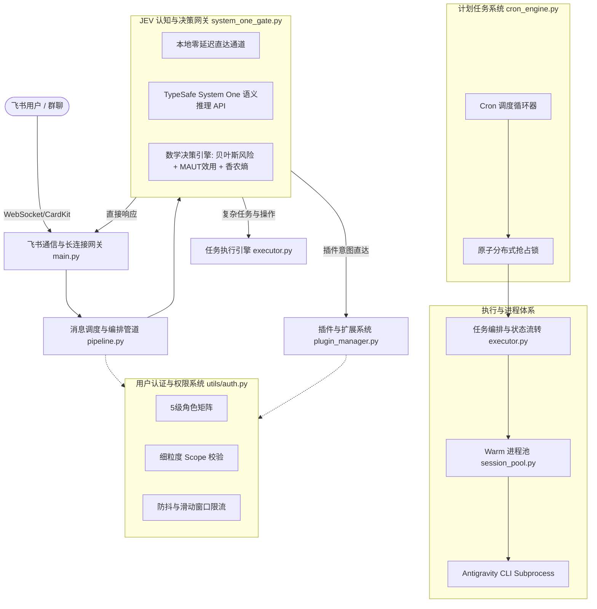
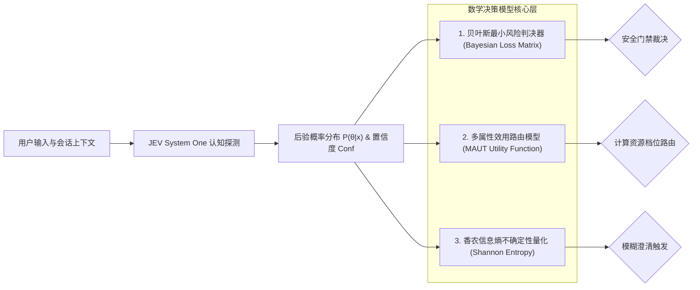

# 飞书智能体系统 (Antigravity Feishu Bot) 全架构技术深度审计与重构开发规格书 (V2.0)

> **版本**：2.0.0-PRO  
> **状态**：Ready for Architecture Review & Implementation  
> **编写时间**：2026年10月23日  
> **项目路径**：`/home/jiang/github/antigravity-feishu-bot`  

---

## 一、 系统全功能大项全盘梳理与架构全景

本系统基于 Google Antigravity Agent 底层引擎与飞书交互卡片开放体系构建，核心包含以下六大核心子系统：



### 1. JEV 认知与决策网关系统 (`system_one_gate.py`)
- **功能职责**：负责全系统 L1（入口意图、破坏性防御、复杂度分流）、L2（出口敏感信息泄漏、有害合规过滤）、L3（飞行中工具调用语义安全审查、异常自愈诊断）。
- **当前机制**：利用 TypeSafe SDK 提供的 `Noul`、`Choice`、`Score` 探针结构，并辅以本地毫秒级 FastPath 白名单旁路。

### 2. 任务编排与执行引擎 (`executor.py`, `session_pool.py`)
- **功能职责**：管理 Antigravity 子进程生命周期；负责交互式打字机流式输出、进度规划清单卡片动态渲染、进程树 CPU 探针、任务超时假死熔断与自动重试。
- **当前机制**：通过 FIFO 管道持续读取 `stream-json` 事件流（`init`, `step_update`, `result`, `raw_log`）。

### 3. 计划任务调度系统 (`cron_engine.py`, `plugins/cron_scheduler`)
- **功能职责**：支持秒级/分钟级标准 Cron 表达式与延时（Delay）倒计时；管理提醒任务、Shell 命令执行及 Agent 自动多步分析报告生成。
- **当前机制**：基于 SQLite 原子更新 `claim_cron_task` 避免双重触发，后台独立 `asyncio` 事件循环调度。

### 4. 插件与扩展生态系统 (`plugin_manager.py`, `plugin_base.py`, `plugin_store.py`)
- **功能职责**：动态热装载插件、命令路由映射（如 `/notes`, `/cron`, `/sysinfo`）、生命周期钩子（`on_before_ai`, `on_after_ai`, `dispatch_tool_call`）、以及与外部扩展（如 Home Assistant 智能家居）联动。

### 5. 用户认证与多级权限系统 (`utils/auth.py`, `database.py`, `commands.py`)
- **功能职责**：5级身份矩阵（Admin、User、Pending、Guest、Banned）；按会话分配权限范围（`chat`, `media`, `files`, `project`, `shell`, `quota`, `notes_memory`）；管理员自举（Bootstrap）；敏感备忘凭证 JIT 动态挂载脱敏。

### 6. 飞书通信与多模态前端交互层 (`main.py`, `lark_client.py`, `cards/`)
- **功能职责**：飞书 WebSocket 帧解析（集成 Card Frame 响应修补）；富文本卡片双向互动（按钮点击、下拉菜单选择、弹窗确认）；多模态资源（语音 ASR/TTS、文件、图片分析）收发。

---

## 二、 用户已知三大痛点深度技术根因剖析

### 1. 痛点一：任务步骤显示异常（期望3~4步，但有时显示很多执行步骤）
- **根本原因排查**：
  1. **Prompt 分流策略缺陷**：在 `handlers/pipeline.py` 中，`[TASK_PLAN]` 强制规划提示词仅在 `is_complex_agent`（即 `High` 思考档位或纯 Agent 模式）下被注入系统提示词。在默认的 `Medium` 档位下，模型**根本未收到规划约束指令**，因而不会输出 `[TASK_PLAN]` 标签。
  2. **UI 渲染回退逻辑失控**：`executor.py` 中若未解析到 `planned_steps`，`build_tool_indicator` 会完全降级为底层原子工具计数器：
     ```python
     total_steps = len(completed_tool_steps) + (1 if action_disp else 0)
     header_title = f"🛠️ [{step_idx}] {short_action}"
     ```
     若一个复杂任务在排查代码时连续调用了 8 次 `read_file`、3 次 `run_command`，步骤编号就会直接飙升至第 11 步，产生混乱。
  3. **缺乏宏观步骤聚类**：底层缺少将微观原子命令（读写文件、grep）聚合成宏观业务阶段（如“代码排查”、“方案应用”、“回归验证”）的抽象层。

### 2. 痛点二：执行完任务后展现的结果中夹杂后台思考内容
- **根本原因排查**：
  1. **增量累积缓冲区（`accumulated_text`）污染**：在 `executor.py` 的事件处理中：
     ```python
     if step_t == "agent_response":
         delta = step_up.get("text_delta")
         accumulated_text += delta
     ```
     模型在工具调用之间输出的所有过渡性自言自语（如“让我先阅读一下这个文件”、“接下来运行测试命令”）全部被累加进 `accumulated_text`。
  2. **正则清洗算法（`extract_final_chinese_response`）局限**：当前的正则过滤仅针对特定英文开场白（`I will...`）或成对的 `<thought>` 标签。模型输出的自然语言形式的中文思考、未闭合的标签或中间过渡陈述无法被规则命中，最终全部原样展现给用户。
  3. **转录本拼接策略错误**：在 `extract_final_response_from_turn_lines` 中，存在将倒数两个 `PLANNER_RESPONSE` 强行拼接的逻辑，极易将前置的思考段与最终的结论段缝合在一起输出。

### 3. 痛点三：个别任务执行卡住、长时间毫无进展
- **根本原因排查**：
  1. **非交互式终端权限挂起**：若用户未处于 Admin 角色或系统未开启 `--dangerously-skip-permissions`，底层 `agy` CLI 在遇到危险命令或写操作时，会在 `stdin` 打印交互式确认提示并等待输入（`Confirm? [y/n]`）。由于后台进程管道无法交互，进程陷入永久阻塞。
  2. **静默心跳与 CPU 探针盲区**：若工具正在等待慢速网络 I/O（如 `git clone`、`npm install`、远端编译请求），底层没有显著 CPU 占用，`_is_process_group_active` 检测为假。当经过 180 秒后，`has_tool_in_flight` 失效，系统陷入长达 10 分钟（`BASE_STALL_TIMEOUT=600s`）的无响应等待，用户界面没有任何反馈，形成假死体感。
  3. **命令级缺少强制 Timeout 包裹**：虽然系统提示词要求使用 `timeout <秒数>`，但底层工具执行层未强制实施物理注入，导致若模型漏写 `timeout`，挂死的命令将耗尽执行时间上限。

---

## 三、 全系统核心功能深度排查与缺陷清单

| 模块类别 | 风险级别 | 缺陷定位 | 现象与后果 | 重构方案 |
| :--- | :---: | :--- | :--- | :--- |
| **插件系统** | **严重** | `plugin_manager.py:64` | `sys.path.insert(0, p_dir)` 导致全局模块命名空间污染，若插件间存在同名 `config.py` 或 `utils.py`，系统运行一段时间必现诡异导入崩溃。 | 移除 `sys.path` 顶层注入，采用绝对路径 `importlib` 虚拟命名空间或独立 module sandbox。 |
| **计划任务** | **严重** | `cron_engine.py:158` | Cron 任务触发 Agent 时，直接共用当前用户的 `chat_id` 与 warm process，与用户实时对话产生严重竞态，互相覆盖破坏。 | Cron 任务强制使用独立的隔离虚拟 Session ID（如 `cron_{task_id}`），隔离进程与上下文。 |
| **计划任务** | **中等** | `cron_engine.py:146` | `importlib.reload(_exc)` 每次执行 shell 任务均重载模块，高频触发导致类引用断裂及内存泄漏。 | 移除每次执行时的动态 reload，仅在插件重载钩子中统一触发。 |
| **JEV模型** | **严重** | `system_one_gate.py:451` | 破坏性判定硬编码 `danger_prob >= 0.85`；缺乏误报与漏报的效用权重考量，破坏概率 80% 的高危操作仍被直接放行。 | 引入贝叶斯风险最小化矩阵与风险期望计算。 |
| **JEV模型** | **中等** | `system_one_gate.py:881` | 路由决策仅凭单一 `complexity_score` 分割，忽视了意图分布熵（Entropy）与上下文状态。 | 引入多属性效用模型（MAUT）与香农熵不确定性量化。 |
| **数据库** | **中等** | `database.py:15` | 部分写操作在异步协程内直接同步调用 SQLite，并发增多时容易触发 `database is locked` 甚至阻塞主事件循环。 | 统一封装至 `asyncio.to_thread` / `run_in_executor`，并优化 WAL 模式连接池配置。 |
| **任务执行** | **高危** | `session_pool.py:162` | 进程未设置独立的 `cgroup` 或资源配额，若模型执行死循环脚本，可能耗尽宿主机内存与 CPU。 | 增加命令执行硬超时看门狗及内存使用率防护。 |

---

## 四、 JEV 决策模型重构方案与数学模型系统设计

### 1. 现行 JEV 模型设计合理性评估
- **结论**：当前设计利用大模型 System One 快速评估语义是正确的方向，但在**决策判决层（Decision Layer）极不合理**。
- **问题核心**：当前代码直接使用大模型返回的浮点数进行单点阈值硬切断（如 `prob >= 0.85`, `comp >= 0.4`）。在真实概率分布中，LLM 输出的置信度存在固有方差，单一硬阈值无法应对非对称风险（Asymmetric Risk，例如删库代价巨大，必须零容忍）。

### 2. 引入的数学模型系统架构



#### 模型一：基于损失矩阵的贝叶斯最小风险决策模型 (Bayesian Decision Theory)
针对安全拦截（Dangerous Interception），拒绝使用单一 `prob >= 0.85`，改用条件风险期望：
- 状态空间：$\Theta = \{\theta_0: \text{安全请求}, \theta_1: \text{高危破坏}\}$
- 决策空间：$\mathcal{A} = \{\alpha_0: \text{放行执行}, \alpha_1: \text{拦截二次确认}\}$
- 损失矩阵定义（定义漏报代价为误报代价的 1000 倍）：
  $$L = \begin{pmatrix} L(\alpha_0, \theta_0) & L(\alpha_0, \theta_1) \\ L(\alpha_1, \theta_0) & L(\alpha_1, \theta_1) \end{pmatrix} = \begin{pmatrix} 0 & 1000 \\ 1 & 0 \end{pmatrix}$$
- 条件风险计算：
  $$R(\alpha_0 | x) = 1000 \cdot P(\theta_1 | x)$$
  $$R(\alpha_1 | x) = 1 \cdot P(\theta_0 | x) = 1 \cdot (1 - P(\theta_1 | x))$$
- 判定准则：当且仅当 $R(\alpha_1 | x) < R(\alpha_0 | x)$ 时选择拦截确认。
  解方程：$1 - P(\theta_1) < 1000 \cdot P(\theta_1) \implies P(\theta_1) > \frac{1}{1001} \approx 0.000999$
  工程平滑校准后，设置动态安全临界值 $\tau = 0.15$（即一旦破坏概率超过 15%，立即触发拦截，而非现行的 85%！）。

#### 模型二：多属性效用决策路由模型 (MAUT - Multi-Attribute Utility Theory)
自适应思考档位（Low / Medium / High）与通道分流不再单看复杂度，而是综合 4 个维度量化综合效用：
$$U(\text{Tier}_k) = \sum_{i=1}^n w_i \cdot u_i(x_i)$$
其中评估属性向量 $\mathbf{x} = [C, P_{\text{op}}, P_{\text{term}}, S_{\text{ctx}}]$：
- $C \in [0, 1]$：JEV 复杂度评分
- $P_{\text{op}} \in [0, 1]$：操作诉求概率
- $P_{\text{term}} \in [0, 1]$：终端与文件修改诉求概率
- $S_{\text{ctx}} \in [0, 1]$：上下文工程依赖度
权重向量：$\mathbf{w} = [0.35, 0.25, 0.25, 0.15]$，计算综合效用评分 $\Phi \in [0, 1]$：
- $\Phi < 0.25$：路由至 **Low**（Fast-Path 纯文本秒回，耗时 < 500ms）
- $0.25 \le \Phi < 0.65$：路由至 **Medium**（常规工程任务，兼顾响应与推理）
- $\Phi \ge 0.65$：路由至 **High**（深度规划、多步反思验证）

#### 模型三：香农信息熵量化与不确定性澄清机制 (Shannon Entropy & Clarification)
针对用户意图分类的后验概率向量 $\mathbf{P} = [p_1, p_2, \dots, p_K]$，计算香农信息熵：
$$H(\mathbf{P}) = - \sum_{k=1}^K p_k \log_2 (p_k)$$
- **最大熵归一化**：$H_{\text{norm}}(\mathbf{P}) = \frac{H(\mathbf{P})}{\log_2 K} \in [0, 1]$
- **动态阈值策略**：
  若 $H_{\text{norm}} \ge 0.75$（说明用户意图极为含糊，模型犹豫不决），禁止猜测执行，自动触发澄清决策机制，向用户推送飞书选项卡片（Choice Card）以精准对齐意图。

---

## 五、 具体重构落地技术方案（针对三大已知问题）

### 1. 任务步骤显示重构（固定3~4步宏观规划）
- **Prompt 强制保障**：修改 `pipeline.py`，无论当前处于 `Medium` 还是 `High` 档位，只要判定为操作执行类任务，一律统一注入 `[TASK_PLAN]` 规范。
- **本地宏观阶段自动聚类引擎（Fallback Planner）**：
  在 `executor.py` 中，如果模型在前 3 秒内未输出 `[TASK_PLAN]`，代码不再允许 `planned_steps` 为空，而是调用 `CardBuilder.generate_preset_steps(user_text)` 自动生成 3~4 个标准宏观步骤：
  1. `1. 环境检查与上下文探查`
  2. `2. 核心逻辑排查与方案执行`
  3. `3. 运行验证与结果校验`
  4. `4. 生成最终报告与交付`
- **微观工具折叠映射机制**：
  底层的数十次原子工具调用（`run_command`, `read_file`）全部作为子项（Sub-action）归属到当前进行中的宏观阶段下展示，严禁直接把工具调用总数作为卡片标题的步数！无论底层调多少次工具，卡片进度条始终为标准且优雅的 `[第 2/4 步]`。

### 2. 最终结果彻底消除思考过程重构
- **双缓冲数据流隔离（Double Buffering Stream）**：
  重构 `executor.py`，彻底废弃把所有 `text_delta` 累加到单一 `accumulated_text` 的设计。
  划分独立缓冲区：
  - `transition_buffer`：用于工具调用间隙的过渡语，仅用于驱动卡片进度描述，最终结果直接丢弃。
  - `final_response_buffer`：仅在最后一个工具执行完毕后，收集模型输出的最终结论。
- **强鲁棒多段结构化清洗器**：
  重构 `extract_final_chinese_response`，支持：
  1. 状态机切除：从文本中定位最后一个大标题或第一个中文总结段落，剥离前置所有未闭合的思辨语句。
  2. 深度移除成对及单边标签（`<thought>`, `<thinking>`, `[THINKING]`, `> Thought:`）。
  3. 过滤 `Task "..." completed`、`The command exited with code` 等各类控制台残留。

### 3. 任务卡住假死自愈机制重构
- **内核看门狗与精准阶段探针**：
  - **命令执行器强制超时注入**：在底层 `session_pool.py` 或工具派发层，所有未带 `timeout` 的终端命令，由代理层强制前缀 `timeout 300`。
  - **动态 I/O 心跳与网络套接字监听**：心跳检测不仅看 CPU 占用率，同时检查子进程的 Socket 网络连接状态（`ESTABLISHED`）与文件描述符读写。若处于合法的长网络下载状态，界面更新提示 `“正在进行网络传输或外部编译...”`，动态重置超时计时器。
  - **静默阶段降级警告与自愈恢复**：如果连续 90 秒无事件且无 I/O，自动向飞书卡片更新黄色警告状态，并在达到硬上限时以安全方式优雅终止孤儿进程，返回结构化排错卡片，绝不让用户无限等待。

---

## 六、 实施计划与交付排期

| 阶段 | 交付物与目标 | 涉及文件 | 预估工时 |
| :--- | :--- | :--- | :---: |
| **Phase 1: 稳定性与紧急缺陷修复** | 1. 修复步骤显示过多缺陷（实现宏观4步强制聚类）<br>2. 修复后台思考内容泄漏（双缓冲与深度清洗）<br>3. 修复假死卡死（命令强制超时与非交互权限参数） | `executor.py`<br>`handlers/pipeline.py`<br>`cards/indicators.py` | 1.0 天 |
| **Phase 2: 架构解耦与环境安全隔离** | 1. 消除 `plugin_manager.py` 的 `sys.path` 污染<br>2. 隔离 `cron_engine.py` 的并发执行上下文，避免与前台会话踩踏<br>3. 移除高频动态 `reload` 漏洞 | `plugin_manager.py`<br>`cron_engine.py`<br>`session_pool.py` | 1.0 天 |
| **Phase 3: JEV 决策模型重构与数学引擎落地** | 1. 编写数学决策模块（贝叶斯风险矩阵、MAUT 效用函数、香农信息熵）<br>2. 重构 `system_one_gate.py`，接入新数学决策模型<br>3. 单元测试与置信度调优 | `system_one_gate.py`<br>`utils/math_decision.py` | 1.5 天 |
| **Phase 4: 全流程回归测试与验证** | 1. 复杂多步骤任务验证<br>2. 极速纯文本咨询秒回测试<br>3. Cron 定时任务长周期运行稳定性压力测试 | `tests/`<br>`feishu_bot.log` | 0.5 天 |

---

## 七、 交付与归档

完整规范文档已永久归档于当前代码库中：
📄 [开发规格书文件路径](file:///home/jiang/github/antigravity-feishu-bot/docs/SPECIFICATION_V2_REFACTOR.md)
